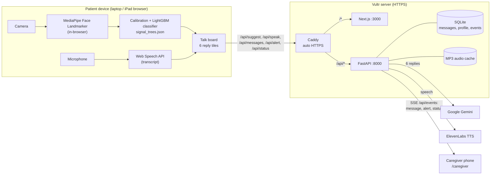

<div align="center">

# 👁️ BlinkTalk

**Talk with your eyes.**

People who can't speak or move (ALS, stroke, paralysis) can hold a real conversation using only eye movements and blinks, tracked live in the browser.

[](https://64-177-56-221.sslip.io)
&nbsp;
[](#team-and-acknowledgements)

**🌐 Live application: [https://64-177-56-221.sslip.io](https://64-177-56-221.sslip.io)**<br>
This is the deployed, working product. Open it in Chrome on a laptop with a webcam. You don't need to clone or install anything.

<a href="https://64-177-56-221.sslip.io"></a><br>
<sub>Scan to open the live demo on a phone. This is handy for the caregiver view.</sub>

</div>

---

## Table of contents

- [The problem](#the-problem)
- [Demo](#demo)
- [Key features](#key-features)
- [How it works](#how-it-works)
- [Architecture](#architecture)
- [Results](#results)
- [Tech stack](#tech-stack)
- [Repository structure](#repository-structure)
- [Run it locally](#run-it-locally)
- [Usage guide](#usage-guide)
- [Configuration](#configuration)
- [API reference](#api-reference)
- [Design decisions](#design-decisions)
- [Limitations and future work](#limitations-and-future-work)
- [Contributing](#contributing)
- [License](#license)
- [Team and acknowledgements](#team-and-acknowledgements)

---

## The problem

Someone with locked-in syndrome, late-stage ALS or a severe stroke is often fully aware but can't speak, type or point. Spelling on a letter board, one blink at a time, is slow and exhausting for both the patient and the caregiver.

## The solution

BlinkTalk turns a conversation into a few eye gestures:

1. The caregiver speaks, and the browser transcribes it.
2. **Gemini** suggests **six likely replies**, using the conversation so far, the patient's profile and the time of day.
3. The patient **looks left or right** to move between six large reply tiles, then holds a **long blink** to choose one.
4. **ElevenLabs** speaks the reply aloud (in a cloned voice when one is configured).
5. Messages and **emergency alerts** reach the caregiver's phone instantly.

Video never leaves the patient's device. Only text and small events are sent to the server.

---

## Demo

| | |
|---|---|
| 🌐 **Live application** | **[https://64-177-56-221.sslip.io](https://64-177-56-221.sslip.io)** (deployed, working product) |
| 💻 **Source code** | You're here |

### Screenshots

<!-- TODO: replace the placeholders below with real screenshots or GIFs saved in docs/assets/ -->

### 60-second walkthrough

1. Open the **[live app](https://64-177-56-221.sslip.io)** on a laptop in Chrome and allow the camera and microphone.
2. Go to **Calibrate** (about 35 s). Follow the prompts: rest, look left ×3, look right ×3, long blink ×3. Your calibration is saved in this browser.
3. Open **Talk**. Speak a question out loud, for example *"Are you thirsty?"*. Six reply tiles appear.
4. **Look left or right** to move the highlight. **Close your eyes for about half a second** (a long blink) to choose a tile. It's spoken aloud.
5. On a phone, scan the QR code above and open **Caregiver**. Messages appear live as they're spoken.
6. To test the alarm, **blink 5 times quickly**. The caregiver gets an emergency alert. A long blink within 5 s cancels it.

---

## Key features

- **Hands-free control.** It runs on gaze and blinks alone, with no keyboard, mouse or touch.
- **Personal calibration.** A 35-second routine adapts the thresholds to each person and each camera, including people who wear glasses.
- **Gesture classifier.** A small LightGBM model, trained on our own labeled recordings, tells deliberate gestures apart from natural blinks and glances. A rule-based fallback is built in.
- **AI reply suggestions.** Gemini returns exactly six short replies grounded in the conversation, the patient's profile and the local time. Off-topic questions are politely redirected.
- **Natural voice.** ElevenLabs text-to-speech, with an on-disk cache and background prefetch of all six tiles, so a chosen reply plays almost instantly.
- **Caregiver view.** Live messages, emergency alerts and patient status (active, resting, face lost) stream to the phone over Server-Sent Events.
- **Emergency alert.** Triggered by 5 quick blinks within 2.5 s or eyes closed for 2–4 s, with a 5-second cancel window.
- **Rest mode.** Eyes closed for more than 5 s pauses input. A long blink wakes it.
- **No double replies.** After a reply is chosen, the tiles stay locked until the caregiver's next message and its new replies are ready.
- **Graceful degradation.** If Gemini is slow or down, default phrases are used. If ElevenLabs fails, the browser's built-in speech is used. If the model can't load, rules take over.
- **Privacy by design.** Face tracking runs in the browser. No images or video are uploaded or stored.

**Demo video:** [Watch BlinkTalk on YouTube](https://youtu.be/gJDuMQ_OrNM)

---

## How it works

| Step | What happens | Where |
|---|---|---|
| **Sense** | The camera feeds Google's **MediaPipe Face Landmarker** (in the browser). Each frame becomes blendshape scores (eye blink, gaze in/out) plus head yaw and pitch. | `web/lib/face.ts` |
| **Decode** | The features are compared with the user's calibration and grouped into 1-second windows every 100 ms. The **LightGBM classifier** (6 classes: idle, natural blink, long blink, left, right, brow up) and a decoder turn them into `move`, `select`, `emergency` and `rest` events. | `web/lib/signals.ts`, `signalCore.ts`, `calibrate.ts` |
| **Understand** | Caregiver speech is transcribed with the **Web Speech API**. The backend asks **Gemini** for six replies (3.5 s limit, then fallback phrases). | `web/lib/stt.ts`, `api/gemini.py`, `api/fallbacks.py` |
| **Act** | The chosen reply is spoken with **ElevenLabs** and stored. Messages, alerts and status are pushed live to the caregiver. | `api/voice.py`, `api/events.py`, `api/db.py` |

### Eye controls

| Gesture | Action |
|---|---|
| Look left / right | Move the highlight |
| Long blink (eyes closed 0.45–1.7 s) | Select the highlighted tile |
| 5 quick blinks within 2.5 s, **or** eyes closed 2–4 s | Emergency alert (cancel within 5 s with a long blink) |
| Eyes closed > 5 s | Rest mode (a long blink wakes it) |

Natural blinks (about 0.1–0.2 s) are ignored. Head turns over about 8° don't count as gaze moves.

---

## Architecture



Only text and small JSON events travel to the server. Video frames never leave the patient's browser.

---

## Results

Measured by the team and shown live on the app's [`/results`](https://64-177-56-221.sslip.io/results) page (source: [`web/public/results.json`](web/public/results.json)).

| What | Result | How it was measured |
|---|---|---|
| Recognizes new users | **60 / 60** long blinks, 47 / 48 left looks, 48 / 48 right looks | Leave-one-person-out across 4 people (each person excluded from the model they were tested on), including sessions with glasses |
| Fewer accidental moves | **59% fewer** than simple rules | During normal conversation: 6.7 accidental moves and fewer than 1 accidental selection per minute |
| Six replies, fast | **1.1 s** typical | All 20 trials finished within 2.25 s after speech recognition |
| Speaks almost instantly | **0.07 s** for a prepared reply | Audio is prepared while the user chooses; new phrases take about 0.3 s |
| Stays on topic | **12 / 12** off-topic questions redirected | All 12 bedside questions were still answered normally |
| Privacy | **0** video frames uploaded | Face tracking runs in the browser |

---

## Tech stack

| Category | Technologies |
|---|---|
| **Frontend** | Next.js 14 (App Router), React 18, TypeScript, Tailwind CSS, Framer Motion |
| **Eye tracking** | Google MediaPipe Face Landmarker (`@mediapipe/tasks-vision`), Web Speech API |
| **Machine learning** | LightGBM (runs in the browser from exported trees), ONNX export, pandas, NumPy, Jupyter |
| **Backend** | Python, FastAPI, Uvicorn, Pydantic, httpx, SQLite |
| **AI services** | Google Gemini (`google-genai`), ElevenLabs text-to-speech |
| **Real-time** | Server-Sent Events |
| **Infrastructure** | Vultr (Ubuntu 24.04), Caddy (automatic HTTPS via Let's Encrypt), systemd, sslip.io |

---

## Repository structure

```
blink-talk/
├── web/                     # Next.js frontend
│   ├── app/
│   │   ├── page.tsx         # home
│   │   ├── calibrate/       # 35 s per-user calibration
│   │   ├── talk/            # patient talk board (6 reply tiles)
│   │   ├── caregiver/       # live messages, alerts, status (phone)
│   │   └── results/         # renders public/results.json
│   ├── lib/                 # face tracking, signal decoding, STT, API client, reply lock
│   └── public/
│       ├── models/          # face_landmarker.task, signal_trees.json, signal.onnx, signal_meta.json
│       └── results.json     # evaluation numbers
├── api/                     # FastAPI backend
│   ├── main.py              # routes
│   ├── gemini.py            # reply suggestions
│   ├── voice.py             # ElevenLabs TTS + MP3 cache
│   ├── events.py            # SSE stream for the caregiver
│   ├── db.py, models.py     # SQLite storage, Pydantic models
│   ├── fallbacks.py         # default phrases when Gemini is unavailable
│   ├── ratelimit.py         # per-IP limits on paid APIs
│   └── smoke.sh             # API smoke test
├── ml/
│   ├── recorder/            # browser tool that records labeled eye-gesture data
│   ├── recordings/          # 10 labeled sessions (numbers only, no images) + README
│   ├── notebooks/           # 02_train_classifier, 04_gemini_prompt
│   └── results/             # classifier and Gemini evaluation output
├── deploy/                  # Caddyfile, systemd units, setup / deploy / rollback scripts, runbook
├── docs/                    # team workflow, infra plan, assets
├── CLAUDE.md                # shared contracts: API, types, env vars
└── .env.example
```

---

## Run it locally

**Requirements:** Python 3.11+, Node.js 20+, and Chrome (for the Web Speech API).

```bash
git clone https://github.com/tupe-atharva/blink-talk.git
cd blink-talk
cp .env.example .env          # add your own keys; never commit .env
```

**Backend** (terminal 1):

```bash
cd api
python3 -m venv .venv && source .venv/bin/activate
pip install -r requirements.txt
uvicorn main:app --reload --port 8000
```

**Frontend** (terminal 2):

```bash
cd web
npm install                   # also copies the MediaPipe wasm into public/mediapipe/
npm run dev                   # http://localhost:3000 (/api/* is proxied to :8000)
```

Check the backend with `curl http://localhost:8000/api/health` (expect `{"ok":true}`) or run `api/smoke.sh`.

> The camera and microphone only work on `localhost` or over HTTPS. To test from another device, use the [live deployment](https://64-177-56-221.sslip.io).

**Retraining the classifier (optional):**

```bash
pip install -r ml/requirements.txt    # on macOS LightGBM may also need: brew install libomp
jupyter notebook ml/notebooks/02_train_classifier.ipynb
```

The notebook trains on `ml/recordings/` and writes the model files into `web/public/models/`. To record new data, serve `ml/recorder/index.html` from a local web server (see [`ml/recordings/README.md`](ml/recordings/README.md)).

---

## Usage guide

| Page | Who | What |
|---|---|---|
| `/` | everyone | Home, with links to every page |
| `/calibrate` | patient | Run once per person or camera (about 35 s). Shows live blink and gaze bars. |
| `/talk` | patient | The talk board. Listens to the caregiver, shows 6 replies, speaks the chosen one. |
| `/caregiver` | caregiver (phone) | Live conversation, emergency alerts, patient status |
| `/results` | judges / team | Evaluation numbers from `results.json` |

**Tips for reliable tracking:** keep the camera at eye level, light your face from the front, and sit about an arm's length away. Recalibrate after changing seat, lighting or glasses.

**Optional URL switches for `/talk`:**

| Switch | Effect |
|---|---|
| `?signals=rules` | Use the rule-based decoder instead of the classifier |
| `?mode=scan` | The highlight moves on its own every 1.5 s, and a long blink selects (no gaze needed) |
| `?dwell=3` | How many 100 ms checks a look must last before the highlight moves (default 3, about 0.3 s) |
| `?blink=0.45` | Seconds the eyes must stay closed to select (default 0.45) |

---

## Configuration

Copy [`.env.example`](.env.example) to `.env` in the repo root. Never commit real keys.

```dotenv
# Gemini reply suggestions
GEMINI_API_KEY=your-gemini-api-key
GEMINI_MODEL=gemini-3.5-flash-lite

# ElevenLabs voice
ELEVEN_API_KEY=your-elevenlabs-api-key
ELEVEN_VOICE_ID=your-voice-id
ELEVEN_MODEL=eleven_flash_v2_5

# Deployment only (Caddy HTTPS)
DOMAIN=your.domain.example
```

| Variable | Needed for | If missing |
|---|---|---|
| `GEMINI_API_KEY` | AI reply suggestions | The talk board shows default phrases |
| `ELEVEN_API_KEY`, `ELEVEN_VOICE_ID` | ElevenLabs voice | The browser's built-in speech is used |
| `GEMINI_MODEL` | Choosing the model | `gemini-3.5-flash-lite` |
| `GEMINI_FALLBACK_MODEL` | Model to try when the main one is overloaded | `gemini-3.5-flash` |
| `ELEVEN_MODEL` | Choosing the TTS model | `eleven_flash_v2_5` |
| `LOCAL_TZ` | Time-of-day context for replies | `America/New_York` |
| `DB_PATH` | SQLite file location | `api/blinktalk.db` |
| `DOMAIN` | Caddy HTTPS on the server | Only used in deployment |

The app runs with no keys at all, using default phrases and browser speech. The keys are needed for the full experience.

---

## API reference

All routes are served under `/api`. The shared contract is in [`CLAUDE.md`](CLAUDE.md).

| Method | Route | Purpose |
|---|---|---|
| `GET` | `/api/health` | Health check: `{"ok": true}` |
| `POST` | `/api/suggest` | Returns 6 reply phrases (`source`: `gemini` or `fallback`). Limited to 30 per minute per IP. |
| `POST` | `/api/speak` | Returns MP3 audio for a phrase. Cached phrases are free; new ones are limited to 20 per minute. Returns 503 so the browser can speak instead. |
| `GET` / `POST` | `/api/messages` | Read or add conversation messages |
| `POST` | `/api/alert` | `emergency` or `emergency_cancelled` |
| `POST` | `/api/status` | `active`, `resting` or `face_lost` |
| `GET` / `PUT` | `/api/profile` | Patient profile (name, caregivers, needs, preferences, common phrases) |
| `GET` | `/api/events` | Server-Sent Events stream: `message`, `alert`, `status` |

---

## Design decisions

- **Video stays on the device.** MediaPipe runs in the browser, and only blendshape numbers are used. This protects patient privacy and keeps the server cheap.
- **Our own classifier on top of MediaPipe.** Fixed thresholds mistook natural blinks and glances while talking for commands. A LightGBM model trained on our recordings cut accidental moves during conversation by 59% compared with simple rules, while still catching almost every deliberate gesture. The model runs in plain TypeScript from exported trees, so it adds no runtime dependency.
- **Emergency gesture redesign.** Our first emergency gesture fired on ordinary blinking during a test demo. We replaced it with 5 quick blinks within 2.5 s (with flicker protection) or eyes closed for 2–4 s.
- **Fewer gestures.** We removed the on-screen keyboard and the eyebrow "undo" to keep control simple: look, long blink, and the emergency gesture.
- **Reply lock.** Tiles lock after a choice until fresh replies arrive, so one blink can't send two answers.
- **Speed limits everywhere.** Gemini has a 3.5 s limit, and replies are capped at 5 s by contract. Audio for all six tiles is fetched in the background as soon as they appear. A keep-warm ping holds the HTTPS connection open.
- **One small server.** Caddy, Next.js and FastAPI (one worker, so SSE subscribers live in memory) on a single Vultr VM. Deploys and rollbacks are one script each.

---

## Limitations and future work

**Current limitations**
- The classifier was trained on 4 people under similar lighting. Accuracy on new faces, cameras and lighting conditions isn't yet measured beyond that.
- Speech recognition uses the browser's Web Speech API, which works best in Chrome and needs an internet connection.
- There's a single shared patient profile and conversation, with no user accounts or authentication.
- The caregiver view doesn't push notifications when the page is closed.
- This is a hackathon prototype, not a medical device, and it hasn't been clinically validated.

**Future work**
- Record more people, including actual patients, and retrain.
- Multiple patients with logins and private conversations.
- Push notifications for emergency alerts.
- Editing the patient profile from the caregiver view.

---

## Contributing

Contributions are welcome:

1. Fork the repo and create a branch from `main`.
2. Make your change and test it locally (`api/smoke.sh` for the backend).
3. Open a pull request using the template in [`.github/pull_request_template.md`](.github/pull_request_template.md).

Team conventions are in [`docs/WORKFLOW.md`](docs/WORKFLOW.md). Shared contracts (API shapes, types, env vars) are in [`CLAUDE.md`](CLAUDE.md). Never commit `.env` or API keys.

---

## License

No license has been chosen yet. Until one is added, all rights are reserved by the authors.
<!-- TODO: add a LICENSE file once the team agrees on one -->

---

## Team and acknowledgements

Built at **UB Hacking 2026** by:

| Member | Role |
|---|---|
| **Yash Varpe** <!-- TODO: GitHub handle --> | Eye tracking, ML classifier, Gemini prompt |
| **Udayan Jadhav (Yudi)** <!-- TODO: GitHub handle --> | Frontend, UI/UX |
| **Atharva Tupe (AT)** <!-- TODO: GitHub handle --> | Backend API, voice |
| **Om Waikar** <!-- TODO: GitHub handle --> | Infrastructure, deployment, live events |

**Thanks to**
- [Google MediaPipe](https://ai.google.dev/edge/mediapipe/solutions/vision/face_landmarker) for the Face Landmarker model.
- [Google Gemini](https://ai.google.dev/) for reply suggestions.
- [ElevenLabs](https://elevenlabs.io/) for text-to-speech.
- [Vultr](https://www.vultr.com/) for hosting, [Caddy](https://caddyserver.com/) for HTTPS and [sslip.io](https://sslip.io/) for DNS.
- The UB Hacking 2026 organizers.
